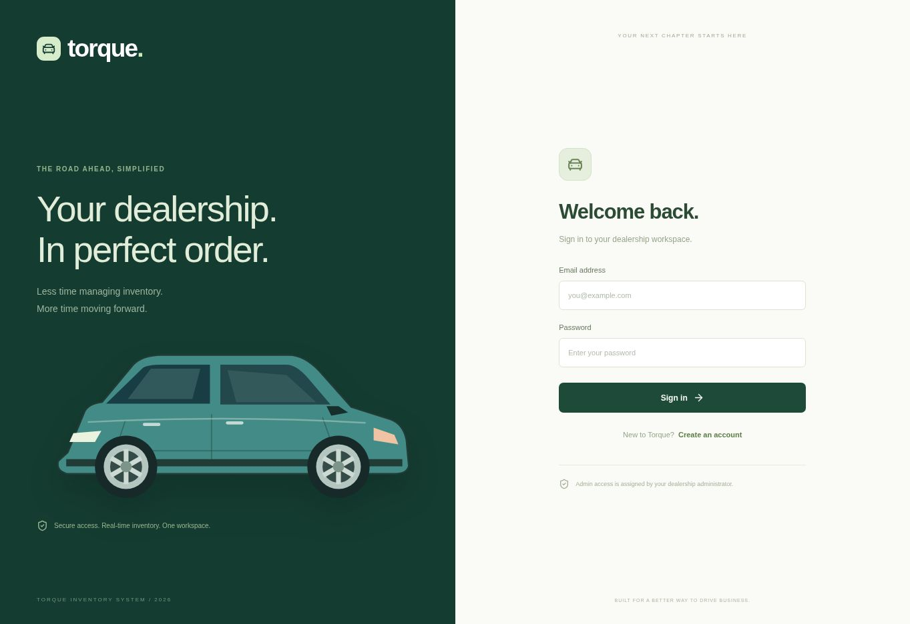
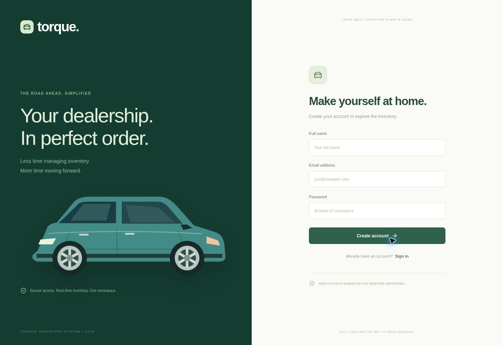

# Torque · Car Dealership Inventory System

A full-stack car dealership workspace built for the supplied **TDD Kata: Car Dealership Inventory System** brief. React and Tailwind provide the single-page frontend; FastAPI exposes the protected REST API; SQLite stores accounts, vehicles, and purchase receipts on disk.

**First time on Windows? Read [START-HERE.md](START-HERE.md).**

## Screenshots

Actual browser captures of the implemented frontend:





Authenticated dashboard and purchase screenshots should be captured during your local demonstration. The build environment could preview the React frontend but could not run Python in its separate browser-preview service. No mocked dashboard screenshots are presented as an integrated browser run.

## Features

- Registration, login, two-hour JWT sessions, and role-aware navigation.
- Vehicle dashboard with stock count, inventory value, and low-stock summaries.
- Search by make/model/category and price range; stock filter; sorting; grid/list views.
- Admin vehicle creation, editing, deletion, and restocking.
- Purchase confirmations, atomic stock decrement, and private receipt history.
- Disabled purchase buttons for zero-stock listings.
- CSV export of the currently filtered inventory.
- Responsive layouts, keyboard-accessible dialogs with focus trapping, request feedback, retry controls, and empty states.
- OpenAPI/Swagger documentation at `/docs` while the backend is running.

## Architecture and data flow

```text
Browser (React + Tailwind)
  -> same-origin JSON requests with Authorization: Bearer <JWT>
  -> FastAPI routes and shared permission dependencies
  -> parameterized SQLite statements and disk transactions
  -> JSON response -> UI refresh
```

The production build is served by FastAPI from `frontend/dist`, so frontend and API use one address. During development, Vite forwards `/api` requests to FastAPI at port 8000. No CORS workaround is required.

All new registrations receive `user` access. Administrator accounts can only be created from the trusted local CLI; the registration endpoint rejects unexpected fields such as `role`. Creating, editing, deleting, and restocking are admin-only. Requiring admin access for create/update is intentionally stricter than the minimum endpoint list and matches the admin-only frontend management forms.

Vehicles have UUIDs, make, model, category, INR price, stock quantity, year, fuel, and color. Prices are stored in integer paise, avoiding floating-point accumulation in the database. Receipts retain the make/model and price at purchase time, so deleting a vehicle does not destroy historical receipts. Each account can only read its own purchases.

Purchases begin a SQLite `BEGIN IMMEDIATE` transaction, decrement only if sufficient stock remains, and insert a receipt in the same transaction. Any failure rolls back both writes. Four competing purchases against one unit are tested: exactly one succeeds. Restocking is also serialized and capped at 100,000 units.

## Requirements

- Python 3.11 or newer (tested with 3.12).
- Node.js 22 LTS or newer and npm for frontend development/rebuilds.
- Git for preserving/publishing the development history.
- Internet for initial dependency installation. After installation, the local app uses no external API, remote fonts, or image services.

The ZIP includes a prebuilt frontend. You can run the application with Python alone; npm is needed after frontend changes. Sample prices are fictional, and original SVG vehicle illustrations represent body categories rather than exact manufacturer models.

## Setup: Windows

Double-click `START-WINDOWS.bat`. It creates a virtual environment, installs pinned Python packages, and runs the app. If the prebuilt frontend is missing, it also runs `npm ci` and builds it.

For manual setup, run in PowerShell from this project folder:

```powershell
py -3 -m venv .venv
.\.venv\Scripts\python.exe -m pip install -r backend\requirements.txt
cd frontend
npm ci
npm run build
cd ..
.\.venv\Scripts\python.exe -m backend.cli create-admin --email admin@example.com --name "Showroom Admin"
.\.venv\Scripts\python.exe -m backend.cli seed
.\.venv\Scripts\python.exe -m uvicorn backend.app:create_app --factory --host 127.0.0.1 --port 8000
```

The admin command prompts twice for your chosen password. The seed command adds eight sample listings only when inventory is empty. It never resets an existing database. Visit **http://127.0.0.1:8000**, then sign in. Ordinary users can register from the page.

## Setup: macOS/Linux

```bash
python3 -m venv .venv
.venv/bin/python -m pip install -r backend/requirements.txt
cd frontend
npm ci
npm run build
cd ..
.venv/bin/python -m backend.cli create-admin --email admin@example.com --name "Showroom Admin"
.venv/bin/python -m backend.cli seed
.venv/bin/python -m uvicorn backend.app:create_app --factory --host 127.0.0.1 --port 8000
```

Alternatively, run `bash start.sh` with the included frontend build, then use the CLI commands for admin/sample setup. Database files are created in `data/` and excluded from Git and the delivered archive. Back up the whole `data/` folder to retain the database and signing secret.

## Frontend development

Keep FastAPI running at port 8000 in one terminal. In a second terminal:

```bash
cd frontend
npm ci
npm run dev
```

Open the URL printed by Vite (normally `http://127.0.0.1:5173`). After edits, run `npm run build` and restart FastAPI if it started before `frontend/dist` existed. The environment-specific allowed host `terminal.local` supports the build-time preview; ordinary local hosts work by default.

## Docker (optional)

```bash
docker compose up --build -d
docker compose exec torque python -m backend.cli create-admin --email admin@example.com
docker compose exec torque python -m backend.cli seed
```

Visit http://127.0.0.1:8000. The named volume keeps data across container replacements. Docker configuration is supplied for convenience; Docker was unavailable and was not exercised in the build environment.

## REST API

| Method | Path | Access | Behavior |
|---|---|---|---|
| POST | `/api/auth/register` | Public | Create a regular account |
| POST | `/api/auth/login` | Public | Return JWT and user profile |
| GET | `/api/auth/me` | Signed in | Current profile |
| GET | `/api/vehicles` | Signed in | List/filter inventory |
| GET | `/api/vehicles/search` | Signed in | Search/filter inventory |
| GET | `/api/vehicles/{id}` | Signed in | Vehicle details |
| POST | `/api/vehicles` | Admin | Add vehicle |
| PUT | `/api/vehicles/{id}` | Admin | Replace vehicle details |
| DELETE | `/api/vehicles/{id}` | Admin | Delete listing, retain receipts |
| POST | `/api/vehicles/{id}/purchase` | Signed in | Decrease stock, create receipt |
| POST | `/api/vehicles/{id}/restock` | Admin | Increase stock |
| GET | `/api/purchases` | Signed in | Current account's receipts |
| GET | `/api/stats` | Signed in | Inventory summary |
| GET | `/api/health` | Public | Health check |

Protected endpoints need `Authorization: Bearer YOUR_TOKEN`.

Registration body:

```json
{"name":"Your Name","email":"you@example.com","password":"YourOwnStrongPassword"}
```

Login body contains only `email` and `password`. Vehicle create/update example:

```json
{"make":"Tata","model":"Nexon EV","category":"SUV","price":1749000,"quantity":5,"year":2026,"fuel":"Electric","color":"Teal"}
```

Purchase/restock body: `{"quantity":1}`. Valid categories: SUV, Sedan, Hatchback, Coupe, Truck, MPV. Fuel: Petrol, Diesel, Electric, Hybrid, CNG. Price must be positive with at most two decimal places; quantity must be an integer from 0 to 100,000. Purchase/restock amounts must be positive integers.

Search parameters: `q`, `make`, `model`, `category`, `min_price`, `max_price`, `in_stock`, `sort`. Sort options are `newest`, `price_asc`, `price_desc`, and `name`. Search terms are parameterized; `%` and `_` are escaped as literal characters. Reversed price ranges return 422.

Typical errors: 401 for an invalid/missing session, 403 for insufficient permissions, 404 for a missing vehicle, 409 for duplicate email/insufficient stock/stock limit, and 422 for invalid input. Purchases return 201 and deletion returns 204.

## Tests and TDD

The repository contains real staged test-first commits, saved failing/passing run logs, and subsequent refactoring. The early red runs fail because behavior is not yet implemented; they are not fabricated after completion. `docs/tdd-*.txt` retains this evidence. The frontend red stage contains the missing App import while existing card tests pass. Authentication tests were corrected to send the strict login schema's email/password fields.

From the project root, on Windows:

```powershell
.\.venv\Scripts\python.exe -m pytest backend/tests --cov=backend --cov-report=term-missing
cd frontend
npm test
npm run build
```

On macOS/Linux replace the Python path with `.venv/bin/python`. See [docs/TEST-REPORT.md](docs/TEST-REPORT.md) for actual results, scope, and limitations. The included Git bundle preserves the history for submission.

## My AI Usage

**Tool:** ChatGPT (Codex coding tools).

**How it was used:** AI generated the initial tests and implementation, proposed the architecture, wrote authentication and transaction code, built the React/Tailwind interface and SVG illustrations, ran the automated checks, fixed validation/configuration failures, and prepared documentation and packaging. No code was copied from another project repository. Third-party dependencies are installed through their package registries.

**Extent of assistance:** The implementation in this package is substantially AI-authored. Do not present it as unaided manual work. Review every file, rerun the tests, and explain the design and tradeoffs in your own words before the interview.

**Reflection:** AI accelerated scaffolding and test iteration, but required validation: strict login payloads, browser-preview compatibility, and persistent transaction semantics needed explicit checks. Passing tests does not prove production readiness. The browser-preview service could not execute the Python runtime, so the integrated browser purchase/admin flow still needs a local walkthrough.

**Co-authorship:** Every development commit includes `Co-authored-by: ChatGPT <chatgpt@users.noreply.github.com>`.

**Raw interaction evidence:** [PROMPTS.md](PROMPTS.md) includes verbatim visible development messages. It is explicitly a partial transcript; add your exported full conversation or genuine public chat share link before submission. A summary is not a substitute for the raw logs required by the brief.

## Publish the Git history

No public repository was created in this session; the available GitHub connection does not provide a new-repository creation operation. Do not use `git init` and squash the project into one commit if the assessor expects TDD history.

Create a new empty public repository in your own GitHub account, then clone the included bundle into a separate folder:

```bash
git clone dealership-history.bundle torque-submission
cd torque-submission
git remote remove origin
git remote add origin YOUR_ACTUAL_NEW_REPOSITORY_URL
git push -u origin main
```

Replace `YOUR_ACTUAL_NEW_REPOSITORY_URL` with the URL returned by GitHub. The bundle intentionally excludes generated frontend output and the local database; rebuild with npm when cloning. The ZIP's working tree includes the prebuilt output for easy running.

Optional live deployment needs a Python-capable host with a persistent disk mounted for `data/`. Static-only hosting cannot execute this FastAPI backend. The Dockerfile is provided as a starting point; deployment has not been performed.

## Project map

| Path | Purpose |
|---|---|
| `backend/app.py` | App factory, registration/login, static frontend serving |
| `backend/dependencies.py` | Shared JWT and role verification |
| `backend/security.py` | Scrypt hashing and token issuance |
| `backend/db.py` | Persistent schema and transaction connections |
| `backend/schemas.py` | Strict API input validation |
| `backend/vehicles.py` | Vehicle, stock, receipt, and summary endpoints |
| `backend/cli.py` | Trusted admin creation and sample seeding |
| `backend/tests/` | Backend integration/security/concurrency tests |
| `frontend/src/App.jsx` | SPA screens, forms, filtering, dialogs |
| `frontend/src/VehicleCard.jsx` | Vehicle card and stock/admin actions |
| `frontend/src/CarArt.jsx` | Original, offline SVG illustrations |
| `frontend/src/api.js` | Authenticated HTTP client and expired-session handling |
| `frontend/src/styles.css` | Tailwind import and responsive styles |
| `frontend/src/*.test.jsx` | Frontend interaction tests |
| `docs/` | Screenshots, TDD evidence, coverage, test reports |

## Troubleshooting and limits

- **Empty inventory:** create your admin account, run the seed command, then refresh. A new database starts empty intentionally.
- **Admin buttons missing:** register creates regular accounts. Sign out and sign in using the account created by `create-admin`.
- **Cannot see the site:** check for `Application startup complete`; open port 8000, not the API docs URL. Rebuild if the frontend output is missing.
- **Address already in use:** stop the previous instance or pass another port (for example 8001) to Uvicorn and open that port.
- **Python not found:** install Python 3.11+ with the launcher, then reopen your terminal. On some Linux systems `python3-venv` is a separate package.
- **Session expired:** sign in again. Tokens expire after two hours. Tokens are stored in sessionStorage for the current tab; there is no refresh-token flow.
- **Data seems different:** run commands from the extracted project root. Use `DATABASE_PATH` only when intentionally changing the database location.
- **Production:** this is an assignment application, with no payments, email verification, password-reset flow, brute-force rate limiting, or immediate token revocation on logout. Use HTTPS, request limits, monitoring, and backups before exposing it publicly. The SQLite design targets a small single-instance deployment.

Environment variables are optional: `DATABASE_PATH` changes the database file and `JWT_SECRET` sets a signing secret of at least 32 characters. Without an explicit secret, one is generated once in `data/.jwt-secret`. Never commit or distribute live account databases or signing secrets.
